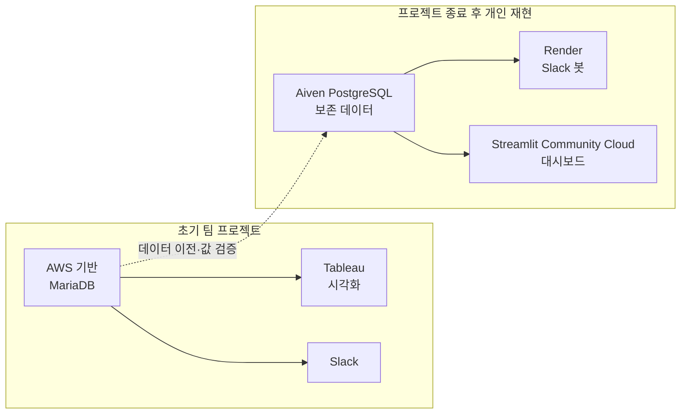
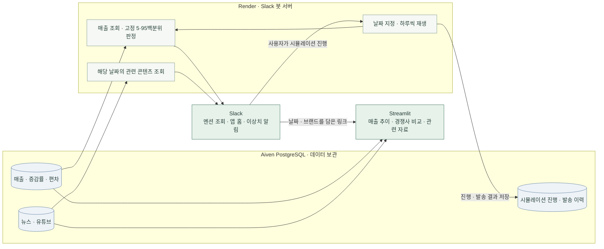
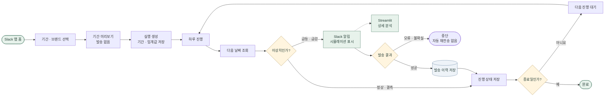

# 편의점 3사 매출 이상 탐지 및 경쟁 동향 분석

**세븐일레븐의 매출 전략 수립을 돕기 위해 CU·GS25·세븐일레븐의 매출 변동을 비교하고,
이상 변동이 발생한 날짜의 뉴스·유튜브를 Slack과 대시보드에서 함께 확인하는 프로젝트입니다.**

경쟁사의 매출 변화와 관련 콘텐츠를 살펴보고 벤치마킹할 이벤트의 단서를 찾는 것이 목적입니다.
뉴스·영상과 매출 변동의 인과관계를 입증하는 서비스는 아닙니다.

팀 프로젝트의 기존 분석·구현을 보존하면서 기능별 구조로 정리하고,
Aiven PostgreSQL·Render Slack 봇·Streamlit 대시보드로 실행 환경을 재구축했습니다.
과거 데이터를 하루씩 조회하는 시뮬레이션으로 이상치 알림을 재현할 수 있습니다.

- [Streamlit 대시보드](https://convenience-store-sales-analysis-srfzzkpg6ixhfihmvgej6l.streamlit.app/)
- [Slack 서버 상태 / 휴면 해제](https://cstore-strategy-demo.onrender.com)
- [시뮬레이션 사용 방법](docs/simulation.md)

## 기획 배경과 분석 범위

팀 프로젝트 당시 세븐일레븐의 경쟁력 강화를 위해 매장 수 확대보다 **매장당 매출을 높일 방법**을 찾고자 했습니다.
발표자료의 2024년 편의점 3사 현황에서는 GS25·CU의 매출 점유율이 약 0.9% 증가하고
세븐일레븐은 약 1.8% 감소하는 추세로 제시됐으며, 세븐일레븐의 감소분은 약 80억 원으로 환산됐습니다.
이는 프로젝트 기획 당시 참고한 시장 현황이며, 아래 대시보드가 보여주는 카드 집계 데이터의 3사 내 매출 비중과는 다른 지표입니다.

발표자료가 인용한 오픈서베이 설문에서는 편의점 선택 요인으로 입지 31.8%, 상품·서비스 29.5%,
가격·혜택 22.1%, 기타 16.6%가 제시됐습니다. 발표자료 표기 기준 응답자는 1,000명이며 신뢰수준은 80%입니다.
이 조사와 경쟁사 상품·이벤트 비교를 바탕으로 트렌드에 맞는 상품과 프로모션 기회를 살펴보고자 했습니다.

현재 서비스는 제공받은 카드 결제 기반 매출 집계와 보존된 뉴스·유튜브 자료를 조회해 경쟁사별 매출 변동과
관련 콘텐츠를 함께 살펴보도록 돕습니다. 특정 상품·이벤트와 이상치 날짜가 겹치더라도 매출 영향의 인과관계를
입증하는 것은 아니며, 벤치마킹과 후속 검토를 위한 단서를 제공합니다. 시장 점유율 수치와 설문 결과는
프로젝트 배경 자료이며 현재 서비스의 매출 DB에서 산출한 값이 아닙니다.

### 분석 방법을 선택한 이유

프로젝트 당시에는 약 1년치 일별 데이터로 여러 이상치 탐지 방법을 검토했습니다. IQR 방식에서는 의미 있는
이상치가 거의 잡히지 않았고, 이동평균 방식은 요일별 매출 패턴의 영향을 크게 받았습니다. 요일을 나눠
비교해도 이 영향이 남았습니다. LSTM 예측은 학습에 사용할 관측치가 약 365개로 적어 실사용할 만큼의
성능을 얻기 어렵다고 판단했습니다.

이에 절대 매출액이나 예측값 대신 **3사의 공통 증감 흐름에서 브랜드별 변화가 얼마나 벗어나는지**를
살펴보는 방향을 택했습니다. 각 브랜드의 일별 증감률에서 같은 날 3사 평균 증감률을 뺀 편차를 구하고,
과거 편차의 고정 백분위 경계로 급등·급감을 판정합니다. 이는 비교 기준을 정하기 위한 선택이며,
상품·이벤트가 매출 변동을 일으켰다는 인과관계를 검증하는 방법은 아닙니다.

### 전략 가설과 사례

입지 확대와 제휴 혜택 확충 외에도, 트렌드와 고객 관심에 맞는 차별화 상품·프로모션을 경쟁사 사례에서
살펴보는 것이 매장당 매출 전략을 위한 하나의 가설이라고 보았습니다. 발표 당시 흑백요리사 등 OTT
콘텐츠 협업, 블루 아카이브 등 모바일 게임 협업, 두바이 초콜릿과 레몬 하이볼 같은 트렌드 상품을
벤치마킹 사례로 검토했습니다.

이 사례들은 기획 당시의 관찰과 제안이며, 본 프로젝트가 각 상품의 매출 상승 효과를 측정하거나 검증한
결과는 아닙니다. 비용 대비 효과나 이벤트 투자수익률도 정량 산출하지 않았으므로, 특정 수익 기준을
입증된 전략으로 제시하지 않습니다.

## 프로젝트 환경의 변화

초기 팀 프로젝트는 AWS 기반 MariaDB와 Tableau를 중심으로 구성했습니다. 프로젝트 종료 후 개인 환경에서
기존 데이터를 다시 준비하고 서비스를 재현하면서 데이터베이스와 배포·시각화 구성을 바꿨습니다.



현재 배포 구성은 초기 AWS·Tableau 환경을 그대로 운영하는 것이 아니라, Aiven PostgreSQL·Render·
Streamlit으로 재구성한 별도 재현 환경입니다. 데이터베이스 이전 후 기존 테이블 9개의 행 값 일치를
검증했으며, 각 서비스의 현재 범위와 제약은 아래 문서에서 설명합니다.

## 주요 기능

| 기능 | 내용 |
|---|---|
| 3사 매출 비교 | 기간·브랜드별 매출 추이, 제공 데이터의 3사 내 매출 비중 |
| 이상치 판정 | 브랜드 증감률과 3사 평균의 편차를 기존 고정 5·95백분위 기준과 비교 |
| 경쟁사 간 비교 | CU−GS25, GS25−세븐일레븐, CU−세븐일레븐 증감률 차이와 쌍별 경계선 |
| Slack 조회·알림 | 브랜드별 매출, 뉴스·영상 조회와 더보기, 이상치 알림·대시보드 이동 버튼 |
| Slack 앱 홈 | 날짜·브랜드 선택, 요약·그래프 이미지 갱신, 관련 자료 조회 |
| 날짜 지정 시뮬레이션 | 기간 미리보기, 하루 진행, 실행별 진행 상태·발송 이력 저장 |

Streamlit은 그래프 확대·마우스 오버 등 상세 탐색을, Slack 홈은 선택 조건에 따른
요약과 그래프 이미지 갱신을 제공합니다. 기본 대시보드 조회 기간은 **2024-11-01~12-31**입니다.

매출 비중은 제공받은 카드 집계 데이터의 3사 내 비율이며 **전체 시장점유율이 아닙니다.**

## 서비스 흐름



`all_sale`의 기존 매출·증감률·편차와 `news_search`, `ytb_video`를 조회합니다.
시뮬레이션에서도 매출을 추가하거나 삭제하지 않고 **기준 날짜만 하루씩 진행**합니다.
서버가 시작되거나 대시보드를 열었다는 이유로 과거 알림을 자동 전송하지 않습니다.

## 이상치 판정 기준

```text
브랜드별 증감률 = (당일 매출 / 전날 매출 − 1) × 100
3사 평균 증감률 = (CU 증감률 + GS25 증감률 + 세븐일레븐 증감률) / 3
편차 = 브랜드별 증감률 − 같은 날짜의 3사 평균 증감률
```

편차의 단위는 **%p**입니다. 2024년 전체 브랜드별 편차의 5·95백분위수를 재계산하고
소수 셋째 자리로 반올림하면 기존 Slack 코드의 임계값 6개와 모두 일치합니다.
상한 이상을 급등, 하한 이하를 급감으로 판정하며 결측치는 제외합니다.
조회 기간을 변경해도 이 고정 기준은 바뀌지 않습니다.

쌍별 비교 그래프의 경계선은 각 쌍의 2024년 증감률 차이에서 별도로 계산한 새 비교 지표입니다.
기존 **브랜드−3사 평균** 기반 알림 기준과 구분합니다.
과거 Tableau의 이동 구간 계산과 발표 그래프의 최종 계산 방식은 별도 미확인 사항으로 보존합니다.

자세한 수치·검증 근거는 [이상치 판정 방법](docs/anomaly_method.md)에 있습니다.

## 날짜 지정 시뮬레이션



Slack 봇의 **홈 → 날짜 지정 시뮬레이션**에서 실행합니다.

1. 시작일·종료일과 대상 브랜드(또는 3사 모두)를 선택합니다.
2. **기간 미리보기**로 예상 이상치를 확인합니다. 알림은 발송하지 않습니다.
3. **새 실행 만들기**로 기간·대상·채널·임계값을 고정해 저장합니다.
4. **하루 진행 · 알림 전송**을 누르면 다음 날짜 한 날만 검사하고 이상치가 있을 때 전송합니다.

기본 시연 기간은 **2024-11-20~11-22 / 3사 모두**입니다.

| 날짜 | 예상 알림 |
|---|---|
| 11월 20일 | CU 급감, GS25 급등 |
| 11월 21일 | CU 급등, GS25 급감 |
| 11월 22일 | 없음. 발송 없이 날짜만 진행 |

알림에는 `[시뮬레이션 · 실행ID]`를 표시합니다. 실행별 상태와 발송 이력은
`simulation.runs`, `simulation.events`에 저장해 서버 재시작 후에도 조회합니다.
같은 실행의 중복·오래된 버튼은 추가 진행하지 않으며, 발송 결과가 불명확하면 멈추고 자동 재전송하지 않습니다.
같은 기간으로 **새 실행**을 만들면 별도 시연이므로 다시 발송할 수 있습니다.

시뮬레이션 그래프·대시보드는 완료된 기준일까지 표시합니다. 다만 임계값은 2024년 전체로
산출했으므로 **과거 동작의 회고적 재현**이며, 미래 정보를 배제한 모델 성능 평가가 아닙니다.
자동 타이머 대신 사용자가 하루씩 진행합니다.

## 데이터와 보존 범위

프로젝트 당시 멘토를 통해 제공받은 약 1년 분량의 **비식별 카드 결제 기반 편의점 매출 집계 데이터**를
사용했습니다. 일자·브랜드별 총매출과 성별·연령대별 집계가 포함됩니다.
원천 제공기관과 구체적인 비식별 처리 방식은 확인되지 않아 별도로 명시하지 않습니다.

현재 보존된 매출 DB 범위는 **2024-01-01~2025-02-06, 3사 합계 1,209행**입니다.
로컬 MariaDB에서 Aiven PostgreSQL로 기존 테이블 9개를 이전했고 모든 행 값의 일치를 검증했습니다.
서비스는 준비된 DB를 조회하며 **원본 데이터·가공 파일·DB 백업은 공개 저장소에 포함하지 않습니다.**

### 사용 데이터와 수집 출처

| 구분 | 데이터 · 보관 테이블 | 확보 경로 | 주요 내용 | 현재 사용 방식 |
|---|---|---|---|---|
| 제공받은 데이터 | 편의점 매출 · `all_sale` | 프로젝트 당시 멘토를 통해 비식별 카드 결제 기반 매출 집계 데이터를 제공받음 | 일자·브랜드별 총매출, 점포 수, 성별·연령대별 매출과 분석용 증감률·편차 | Slack 매출 조회·이상치 판정, Streamlit 분석, 과거 알림 재현 |
| 수집 데이터 | 뉴스 · `news_search` | 기존 프로젝트의 네이버 기사 검색 결과 | 제목, 기사 URL, 요약, 날짜, 언론사, 브랜드 | 보존된 DB에서 날짜·브랜드별 관련 기사 조회 |
| 수집 데이터 | 영상·채널 · `ytb_video`, `ytb_channel` | 기존 프로젝트의 YouTube 자료 | 영상·채널 정보, 게시일, URL, 조회 수 등 | 영상 테이블을 관련 콘텐츠 조회에 사용. 채널 테이블은 보존 |
| 수집 데이터 | 브랜드 행사 · `event_img` | CU·GS25·세븐일레븐 공식 페이지를 조회하는 기존 수집 코드 | 행사 제목·기간·이미지 URL·브랜드 | 기존 데이터와 수집기 보존. 현재 핵심 조회 화면에는 미연결 |
| 수집 데이터 | 증정 상품 · `event_plus` | Pyony 브랜드별 상품 페이지를 조회하는 기존 수집 코드 | 상품명, 가격, 행사 가격·유형, 수집 시점 | 기존 데이터와 수집기 보존. 재수집 동작은 별도 검증 필요 |
| 보조 분석 자료 | 검색 트렌드 · `naver_search_trend` | 기존 네이버 검색 트렌드 자료. 수집 조건은 미확인 | 날짜별 브랜드·편의점 검색 지표 | 기존 DB·파일 적재 도구 보존. 현재 핵심 서비스에는 미연결 |
| 보존 자료 | `people`, `hospital_sale` | 원천 출처·가공 과정 추가 확인 필요 | 지역·인구·좌표 관련 열, 매출·점포 수 관련 열 | 원본 보존을 위해 이전. 테이블 이름만으로 용도를 확정하지 않음 |
| 서비스 생성 데이터 | `simulation.runs`, `simulation.events` | 사용자의 시뮬레이션 실행 과정에서 생성 | 실행 기간·대상·진행 상태, 알림 발송 결과 | 매출 원본과 분리해 진행 상태·중복 발송 방지에 사용 |

**현재 서비스의 데이터 갱신은 실시간 외부 수집이 아니라 보존된 DB 조회를 기준으로 합니다.**
시뮬레이션은 새 매출을 수집·적재하는 기능이 아니라 기존 날짜의 알림을 재현하는 기능입니다.
뉴스·영상의 최초 수집 API, 검색 조건, 갱신 주기는 남아 있는 자료만으로 확정하지 않습니다.
표의 출처는 기존 데이터·코드에 근거한 설명이며, 현재 각 사이트에서 재수집이 가능하다는 뜻은 아닙니다.

전체 테이블의 주요 열과 출처 확인 수준은 [데이터 사전](docs/data_dictionary.md)에 정리했습니다.

기존 행사·증정 상품 수집기는 보존했으며, 현재 사이트에 대한 재수집·운영 검증은 별도 작업입니다.
뉴스·영상 최초 수집·적재 코드가 모두 남아 있는 것은 아닙니다.
과거 Tableau 자료와 링크 기능, 성능 문제로 제외했던 예측 코드, 웹 시제품은 보관했습니다.
예측·회원가입·로그인은 현재 핵심 서비스 기능에 포함하지 않습니다.

## 프로젝트 구조

```text
cv_store/
  config/                 환경변수·기준 경로
  database/               DB 연결·조회·이전 검증 도구
  analysis/               기존 매출 편차 임계값 판정
  dashboard/              Streamlit 화면·집계·차트
  simulation/             날짜 재생·실행 상태·중복 발송 방지·Slack UI
  integrations/slack/     봇·멘션·알림·앱 홈·그래프 이미지
  collectors/             기존 행사·증정 상품 수집
  ingestion/              필요 시 사용하는 고정 파일 검증·적재
  jobs/                   명시적 수집·알림·시뮬레이션 미리보기 CLI
  web/                    선택적 기존 매출 JSON API
dashboard/                Community Cloud 진입점·전용 의존성
database/schema/          데이터 행 없는 DB 스키마 SQL
config/                   Slack 앱 manifest
requirements/             Slack 서버·대시보드별 의존성
docs/                     분석 근거·실행·배포·보관 설명
tests/                    합성 자료를 이용한 오프라인 검증
archive/                  과거 구현·예측·실험·웹 시제품
data/                     안내문만 공개. 데이터 파일은 Git 제외
runtime/                  로컬 상태·인증서·검증 결과. Git 제외
streamlit_app.py          로컬 대시보드 진입점
```

## 로컬 실행과 테스트

Python **3.12 권장**입니다. 공개 저장소에 원본 데이터는 없으므로 실제 조회에는 별도로
준비한 DB와 연결 설정이 필요합니다. 합성 자료를 사용하는 테스트는 원본 데이터 없이 실행할 수 있습니다.

```powershell
python -m venv .venv
.\.venv\Scripts\python.exe -m pip install -e ".[dev]"
.\.venv\Scripts\python.exe -m pip install -r requirements/dashboard.txt -r requirements/slack-bot.txt

# 처음 설정할 때만 예제 복사. 기존 .env는 덮어쓰지 않습니다.
if (!(Test-Path .env)) { Copy-Item .env.example .env }

# 외부 DB·Slack·수집 사이트에 연결하지 않는 테스트
.\.venv\Scripts\python.exe -m pytest -q

# 로컬 대시보드 → http://127.0.0.1:8501
.\.venv\Scripts\python.exe -m streamlit run streamlit_app.py --server.address 127.0.0.1 --server.port 8501

# 로컬 Slack 봇. 동일 앱의 Render 봇과 동시 실행하지 않는 것을 권장합니다.
.\.venv\Scripts\python.exe -m cv_store.integrations.slack.app

# 조회·미리보기만 실행. DB 쓰기·알림 발송 없음.
.\.venv\Scripts\python.exe -m cv_store.jobs.simulate_sales --start 2024-11-20 --end 2024-11-22
```

시뮬레이션을 새 DB에서 사용하는 경우 다음 명령으로 전용 테이블을 준비합니다.
일반 봇 시작이나 화면 방문 시 스키마를 자동 생성하지 않습니다.

```powershell
.\.venv\Scripts\python.exe -m cv_store.simulation.setup
```

환경변수 이름은 [.env.example](.env.example)에 있습니다. DB 설정·CA 인증서가 필요하며,
봇에는 별도 Slack 토큰·채널 설정이 필요합니다. Streamlit에는 DB 설정만 전달합니다.
`.env`, `.streamlit/secrets.toml`, 인증서·원본 파일은 커밋하지 않습니다.
과거 파일 적재 도구는 일반 실행에 필요하지 않으며 기존 DB에 임의로 재적재하지 않습니다.

## 배포와 검증 상태

- **Aiven PostgreSQL:** 기존 DB 이전·값 검증 완료, 시뮬레이션 전용 스키마 준비 완료.
- **Render Free:** Socket Mode Slack 봇 배포, 매출 조회·뉴스/영상 더보기·알림과 앱 홈 조작 확인.
- **Streamlit Community Cloud:** 대시보드 배포, Slack 대시보드 URL 연결.
- **시뮬레이션:** 날짜 범위 검증, 상태 저장·소유자 격리·중복 방지·진행/완료를 테스트하고 서버에 배포.
  실제 Slack에서 기간 선택·단계별 발송하는 시연은 별도로 확인합니다.
- **자동 테스트:** 대시보드·홈·시뮬레이션 의존성을 설치한 환경에서 72개 통과(2026-11-02).
  실제 PostgreSQL 상태 전이 검증 행은 롤백했으며 자동 검증에서 실알림은 발송하지 않았습니다.

무료 Render 서버가 휴면 중이면 먼저 [서버 상태 URL](https://cstore-strategy-demo.onrender.com)을 열어
`slack_connected: true`를 확인한 뒤 Slack을 사용합니다. 24시간 무중단 자동 모니터링을 보장하지 않습니다.

## 상세 문서

- [이상치 계산식·임계값 검증](docs/anomaly_method.md)
- [날짜 지정 시뮬레이션](docs/simulation.md)
- [Slack 앱 홈](docs/slack_app_home.md) · [앱 설정](docs/slack_setup.md)
- [Streamlit 대시보드 실행·배포](docs/streamlit_dashboard.md)
- [Render 무료 시연용 배포](docs/render_demo.md)
- [Aiven PostgreSQL 연결·원본 DB 점검](docs/postgresql_setup.md)
- [데이터 출처·DB 계약](docs/data_dictionary.md)
- [기존 구조 분석·파일 대응표](docs/reorganization.md) · [파일 이동 기록](docs/file_manifest.json)
- [과거 구현 보관 정책](archive/README.md) · [운영 기록](docs/operations.md)
